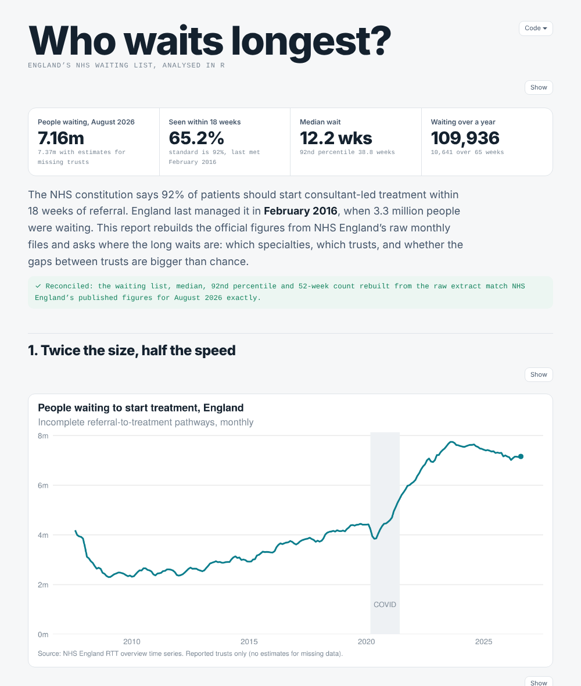
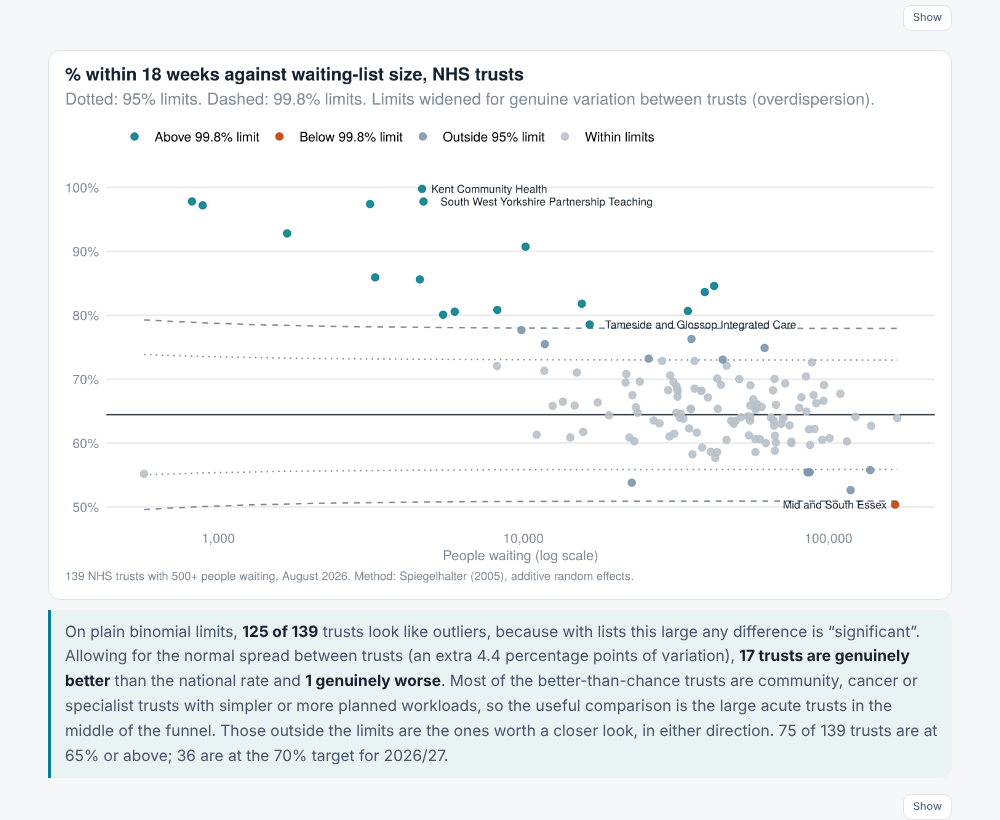

# Who waits longest? England's NHS waiting list, in R

**NHS England's raw Referral to Treatment (RTT) files, cleaned and analysed in R: how the waiting list grew, which specialties wait longest, and which trusts are really different from the rest once chance is allowed for. Both raw files, the cleaned tables, the R code and the tests are in this repo, and the rebuilt figures match the published ones exactly.**

Track: Health Data · R (tidyverse, ggplot2, R Markdown, testthat) · [Live report](https://qaisbello.github.io/health-data/waiting-list-r/)



## What it finds (August 2026)

| Question | Finding |
|---|---|
| How big is the list? | **7.16 million** pathways waiting (7.37m with estimates for missing trusts). It peaked at 7.75m in August 2023; before COVID it was 4.42m. |
| How fast? | **65.2%** within 18 weeks; the median wait is **12.2 weeks** and 8% wait more than **38.8 weeks**. The 92% standard was last met in **February 2016**. |
| Targets | The 65% interim target for March 2026 was met. The 2026/27 target of 70% is 4.8 points away. |
| Longest specialty waits | **Oral surgery**: 53.8% within 18 weeks. Ear, nose and throat 56.8%. Trauma and orthopaedics has the most people waiting a year or more (19,741). |
| Which trusts are different? | On plain binomial limits, **125 of 139** NHS trusts look like outliers. Allowing for genuine between-trust variation (overdispersion), **17 are better than chance and 1 is worse**. |
| NHS vs independent sector | 74.7% vs 64.4% within 18 weeks, but independent providers hold 6.1% of the list and take mostly routine cases: not like-for-like. |



## Raw to clean

| File in `data/raw` | Problems handled in `scripts/01_clean.R` |
|---|---|
| `RTT-Overview-Timeseries-...xlsx`: monthly England figures since 2007 | Title block and two-row header; columns found by header text, not position; `-` (not collected) kept as missing, not zero; the 92nd percentile recorded as text `52+` in early months, flagged; a column labelled "(mil)" that actually holds counts; footnotes under the table |
| `Full-CSV-data-file-Aug26-ZIP-...zip`: every provider x commissioner x specialty, August 2026 (177,770 rows, 121 columns), read straight from the zip | Part 2 (still waiting) separated from completed pathways and new referrals; blank `Total` column rebuilt from 105 weekly bands; specialty `Total` rows used for trusts and England, specialty rows for specialties, so nothing is counted twice; 31,049 patients with non-English commissioners (`NONC`) excluded from England figures to match the published commissioner basis |

**Reconciliation:** the waiting list (7,158,164), median (12.21 weeks), 92nd percentile (38.80 weeks) and over-52-week count (109,936) rebuilt from the extract equal NHS England's published figures. A test enforces it.

## Methods worth knowing

- **Percentiles from banded data** (`wait_percentile()`): waits are spread evenly within each one-week band and the median and 92nd percentile interpolated, which is NHS England's own method. That's why the rebuilt figures match to the hundredth of a week.
- **Overdispersed funnel plot** (`funnel_overdispersed()`): with lists of 100,000 patients, binomial limits are so tight that nearly every trust is "significant". Following Spiegelhalter (2005), an additive random-effects term is estimated from winsorised z-scores and added to each trust's variance, so only trusts that differ beyond normal between-trust variation are flagged.

## Power BI version

The same analysis as a Power BI report, in [`powerbi/`](powerbi/): England trend, specialties and providers, and the funnel plot. Every headline figure is checked against the R results. Open `powerbi/RTT_Waiting_List.pbip` in Power BI Desktop and click Refresh; it reads `data/clean` from this repo.

## Run it

```r
# R 4.3+, packages listed in DESCRIPTION
source("scripts/01_clean.R")                       # data/raw -> data/clean + data_quality_log.csv
source("scripts/02_analyse.R")                     # summary.json, funnel_trusts.csv
testthat::test_dir("tests/testthat")               # 15 tests
rmarkdown::render("report/index.Rmd", output_dir = "web")
```

GitHub Actions runs all four steps on every push.

## Repo layout

```
data/raw/      the two files exactly as downloaded from NHS England
data/clean/    england_timeseries, specialty_summary, provider_summary, provider_specialty, funnel_trusts, summary.json, data_quality_log
R/rtt.R        reading, cleaning, percentile and funnel functions
scripts/       01_clean.R, 02_analyse.R
report/        index.Rmd (+ style.css) -> web/index.html
tests/         testthat
```

## Source and licence

NHS England, *Referral to Treatment (RTT) Waiting Times*, August 2026 full CSV extract and overview time series. Contains public sector information licensed under the Open Government Licence v3.0. Targets from NHS England planning guidance.

---

Built by [Qais Adeniji-Bello](https://qaisbello.github.io) · [LinkedIn](https://www.linkedin.com/in/qais-adeniji-bello/)
