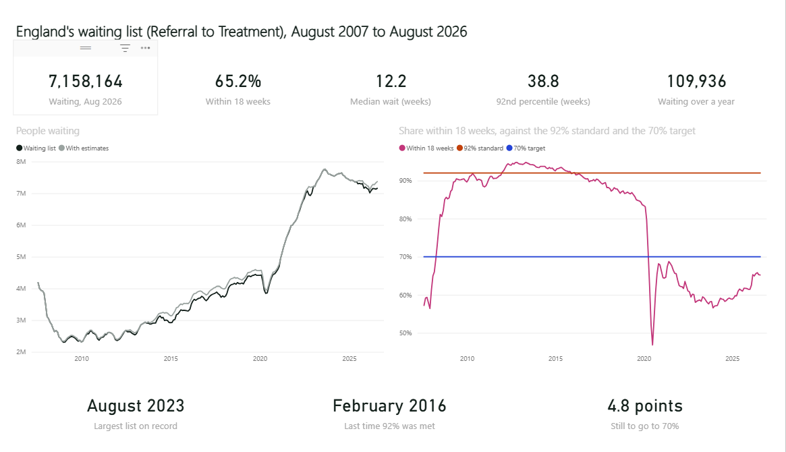

# Who waits longest? (Power BI)

England's NHS Referral to Treatment waiting list: the national trend since 2007, specialties and providers in August 2026, and the overdispersed funnel plot of 139 NHS trusts.

This folder is a Power BI project (`RTT_Waiting_List.pbip`): a TMDL semantic model and a PBIR report. It is generated from one Python spec, checked against Microsoft's JSON schemas, and its numbers are recomputed independently in pandas.



*In Power BI Desktop after a refresh. Every card matches `docs/expected_values.md`.*

## Open it

1. Open **`RTT_Waiting_List.pbip`** in Power BI Desktop. In versions before mid-2025, first turn on the preview features for Power BI Project (.pbip), the TMDL model format and the PBIR report format.
2. Click **Refresh**. The model reads this repo's cleaned CSVs from GitHub through the **BaseUrl** parameter. If asked, choose **Anonymous** access for `raw.githubusercontent.com`.
3. Check the visuals against [`docs/expected_values.md`](docs/expected_values.md).

## Pages

- **England:** waiting list, share within 18 weeks, median and 92nd percentile, over-52-week waits; the list since 2007 with and without estimates; performance against the 92% standard and the 70% target.
- **Specialties and providers:** share within 18 weeks by specialty; every provider with its list, share and long waits; NHS vs independent sector slicer; click a specialty to filter.
- **Funnel plot:** trust size against performance coloured by the funnel band from R; binomial vs overdispersed outlier counts; trusts by z-score.

## Model

- **Tables:** England, Providers, Specialties, Waiting by Provider, Funnel.
- **Relationships:** Waiting by Provider[provider_code] to Providers[provider_code]; Waiting by Provider[specialty_code] to Specialties[specialty_code].
- **26 DAX measures** in display folders: England (Latest Month, Waiting List, Waiting List with Estimates, % Within 18 Weeks, 92% Standard, 70% Target, Latest Waiting List, Latest % Within 18 Weeks, Latest Median Wait, Latest 92nd Percentile, Latest Over 52 Weeks, Peak Waiting List, Peak Month, Last Month 92% Was Met, Gap to 70%); Providers (Pathways, Provider % Within 18 Weeks, Provider Over 52 Weeks, Share of List); Specialties (Specialty % Within 18 Weeks, Specialty Over 52 Weeks); Funnel (Funnel List Size, Funnel % Within 18 Weeks, Trusts Better Than Chance, Trusts Worse Than Chance, Binomial Outliers). The full DAX is in [`docs/measures.md`](docs/measures.md).

## Notes

- Medians and 92nd percentiles were interpolated within weekly bands in R (NHS England's method). They cannot be added up, so the model shows them at the grain they were calculated and never sums them.
- The provider extract includes 31,049 pathways commissioned outside England, so provider totals are 0.4% above the England headline. Each table says which it uses.
- `tools/expected.py` checks every headline card against the R results in `data/clean/summary.json`: all agree.

## Rebuild and check

```bash
pip install jsonschema referencing pandas numpy
python tools/spec.py        # the spec: writes the .pbip and its folders
python tools/validate.py    # Microsoft schemas, field and DAX references, name clashes
python tools/expected.py    # what the report should show, checked against the project's own results
```

`tools/pbikit.py` is a small shared library for writing Power BI projects as code. It is used across the portfolio and encodes lessons from real Power BI Desktop runs: names are case-insensitive; a format string must not start with a quote; empty CSV cells must become null before a type change; in DAX, `BLANK() = FALSE()` is true.
